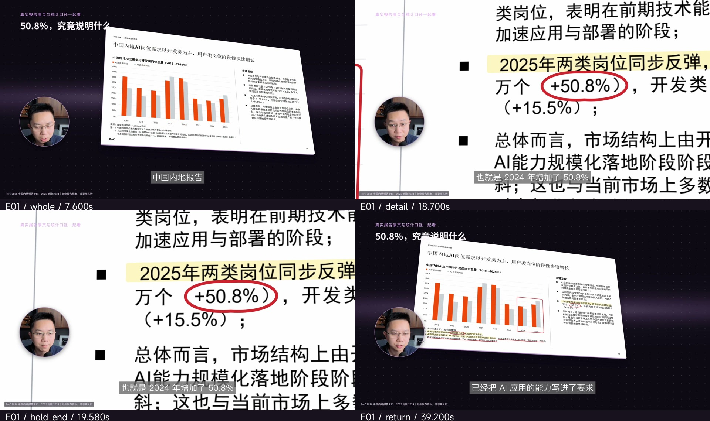

# 课程长视频剪辑 Skill

当前版本 **v1.6.2**。面向人像口播、录屏教学及混合课程，包含完整制作方法、默认组件、四段实际动态样片、原版MiSans与许可、学员资料模板及检查脚本。

## 安装

把下面这段话交给Codex或支持本地Skill的Agent：

```text
请使用skill-installer安装完整课程剪辑技能：
https://github.com/superslash-rico/course-long-video-editing/tree/v1.6.2/course-long-video-editing
已有旧版先核对本机改动并完整备份，再按随包安装器升级，不能覆盖自定义资料。
```

也可下载[完整ZIP](https://github.com/superslash-rico/course-long-video-editing/releases/download/v1.6.2/course-long-video-editing-v1.6.2.zip)和[SHA256](https://github.com/superslash-rico/course-long-video-editing/releases/download/v1.6.2/course-long-video-editing-v1.6.2.sha256)。完整解压后按[开始使用](course-long-video-editing/开始使用.md)安装，保留相对目录。安装后下一轮或新会话读取实际目录的版本。

```sh
git clone --branch v1.6.2 https://github.com/superslash-rico/course-long-video-editing.git
cd course-long-video-editing
python3 course-long-video-editing/scripts/verify_package.py
python3 course-long-video-editing/scripts/install_skill.py
```

已识别且未修改的旧包可显式使用`--upgrade --backup-root "备份目录"`。未知或改过的安装保留并检查合并，不覆盖整个Agent配置。

## 先看实际样片，再制作新课

[样片导览与观察说明](course-long-video-editing/references/example-guide.md)是当前视觉基线。四段均附全景、细节抵达、停留末端、返回四状态帧。先看动态，再把机制用于自己的内容。

| 样片 | 动态文件 | 观察重点 |
|---|---|---|
| E01 报告原页与数字特写 | [40秒MP4](course-long-video-editing/assets/examples/quality-baseline/clips/E01.mp4) | 原页圈选/高亮，大幅推近，读时慢推与口径回收 |
| E02 岗位条件与验证条款 | [37秒MP4](course-long-video-editing/assets/examples/quality-baseline/clips/E02.mp4) | 企业匿名，条件在原文里阅读，保留验证要求 |
| E03 项目记录的纵深与归组 | [24秒MP4](course-long-video-editing/assets/examples/quality-baseline/clips/E03.mp4) | 厚度、遮挡、透视、特写与整体收拢 |
| E04 练习段中的原文任务 | [34秒MP4](course-long-video-editing/assets/examples/quality-baseline/clips/E04.mp4) | 回顾/课后练习也在原件里划线、高亮 |



本机播放页：

```sh
python3 course-long-video-editing/scripts/reference_preview.py
```

脚本打印本机地址，播放页支持跳到四个观察状态。视频和图片随包提供，不依赖原作者电脑、账号或原生工程。[公开范围与出处](course-long-video-editing/assets/examples/quality-baseline/rights.md)保留第三方摘录权利。用户明确授权这四段精选课程成片作为公开参考；不包含整课、原片、账号或完整工程，也不把Rico口播直接用作别人的新课。

## 下次执行时的质量要求

- 按本次阶段读取文件，记录实际版本、规则和适用样片摘要；不用历史聊天或旧备份猜当前标准。
- 网页、报告和招聘事实直接在真实原件中圈框、高亮、划线，图像和标记共享源坐标；不再抄成独立证据卡。
- `CourseWorld`让背景和前景共用相机；全景到特写有强尺度差，细节尽量大且完整，阅读时保持缓慢运动。
- `SourceCredit`把来源说明自动固定在屏幕左下小字层；原件批注继续随原件移动。局部动画的来源层也按整幅输出画面定位。
- 先做当前课程代表段，与适用样片生成实际画面对照，修复后再扩展。版本、源码、参数或输出变更后，旧证据失效。
- 交审核前检查全课全部来源引用，包括回顾、练习和结尾；用户动画审核通过后再进入正式成片和课程资料。

```sh
python3 course-long-video-editing/scripts/workflow_gate.py prepare --stage animation --profile mixed --output "本课/工作文件/质量会话-v1"
```

`prepare`仅生成必读路径与版本锁，不代表已看过。实际导出后按[检查契约](course-long-video-editing/references/check-record-contract.md)生成双行四状态对照并记录真实观察。检查脚本不证明观看行为、美感、事实真伪或听感。

## 完整流程与条件

确认标题、建档归类 → 按需粗剪 → 用户片头片尾衔接 → 字幕 → 真实材料 → 专业解释动画 → 适用的名签/金句 → 审核 → 成片、标题简介、品牌学员PDF → 复盘。

已粗剪直接进入后续环节，保护原声与自然教学节奏。录屏保留真实点击—状态—结果，便于跟做。用户封面及首尾素材沿用原件，不默认重做。AI图片只能是明确示意，不能伪装成真实证据。

接收方需要自己的ChatCut Desktop、当前Agent集成、课程素材和合法服务；按当前schema/画幅/fps重新绑定资产。安装Skill不等于注册系统字体。学员PDF生成另需ReportLab/Pillow或等价工具。详细入口：[SKILL.md](course-long-video-editing/SKILL.md)、[组件说明](course-long-video-editing/references/reusable-production-kit.md)、[同事首次验收](course-long-video-editing/references/colleague-pilot.md)。

## 验证与边界

[验证报告](course-long-video-editing/validation/report.json)和[20项落实表](course-long-video-editing/validation/20-point-audit.md)保留分项范围。当前代码包含版本/证据门禁29项、既有合成保护46项、相机17项及来源布局检查。实际样片解码、原生位置与共享相机另有本机验证；独立新上下文试跑已检验样片路径的使用及未测状态的保留。

GitHub Actions核对资源/字体、相对依赖、保护规则、镜头、来源位置、阶段证据及隔离安装。它不代替真实新课的原声合成、连续观看/听审、用户审美或第二台电脑验收。旧中性工程示范保留技术研究用途，不能取代E01—E04作为当前效果参考。每一新课仍需实际代表段对照与全课检查。

## 资源与维护

逐项资源遵守[来源与使用说明](course-long-video-editing/THIRD_PARTY_NOTICES.md)及[文件清单](course-long-video-editing/assets/manifest.json)，没有对字体、品牌、第三方摘录或所有代码统一授予MIT等许可。未经公开授权的课程、客户资料和账号仍留项目；本次明确授权的精选样片按权利说明公开。

通用经验维护本机Skill；GitHub发布按用户当次授权执行。[变更记录](course-long-video-editing/CHANGELOG.md)。
